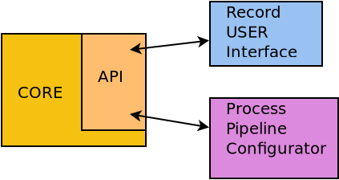

# Record3k

Real-time tracking of small moving objects (e.g. insects) in GigE camera streams, with GPU support.
A C++ image-processing library (OpenCV, optionally CUDA) runs a configurable pipeline at 5+ FPS per camera. A Drogon REST API controls cameras, pipelines and recordings, and a small web client sits on top.



## Repository layout

```
src/liblbt/          image-processing library: frame sources, pipeline + steps, record manager
src/api/             apiserver: Drogon REST API (built with CONFIG+=api)
src/pipelineviewer/  Qt desktop viewer / tagging tool (disabled in record3k.pro by default)
client/              static web UI (HTML/JS), served by Caddy; openapi.json
config/              common.pri (shared qmake settings), base-image Containerfiles, examples/ (initial data)
scripts/             podman helpers and launcher scripts
tools/               record archiving / admin scripts (Python, talk to the API)
doc/                 architecture notes and how-tos, see doc/README.md
Dockerfile, compose.yaml, entrypoint.sh   container build and deployment
localBuild.sh, localClean.sh              host build
```

Not in the repo: `vimbax/` (Allied Vision VimbaX SDK, proprietary), `data/` (runtime data), `build/`, `logs/`.

## Build option A: local build on the host

**Dependencies** (Debian 13 / Ubuntu 24.04):

```bash
sudo apt install build-essential pkg-config qt6-base-dev qmake6 \
                 libdrogon-dev libjsoncpp-dev libsqlite3-dev
```

- **OpenCV 4** with `opencv4.pc` for pkg-config. For a CPU-only build, the distro `libopencv-dev` is enough. For `--cuda`, build OpenCV 4.13 + opencv_contrib with CUDA from source; the exact cmake flags are in [config/DockerBuildOpenCV](config/DockerBuildOpenCV).
- **CUDA 12.9 + cuDNN** (only for `--cuda`)
- **VimbaX SDK** (only for `--vimbax`): download it from Allied Vision and copy/symlink its `api/` and `cti/` folders to `./vimbax/` (so you get `vimbax/api/include`, `vimbax/api/lib` and `vimbax/cti`)

**Build:**

```bash
./localClean.sh                                  # fresh build/ + initial config in build/bin, VimbaX libs in build/lib
./localBuild.sh --cuda --vimbax --api -j 8       # full build
./localBuild.sh --api -j 8                       # CPU-only, without cameras (VimbaX)
```

More flags: `--debug`, `--log-level DEBUG`, `--clean`, `--x <binary>` (run after the build), `--valgrind` / `--valgrind-memcheck`.
Output goes to `build/bin` (apps) and `build/lib` (liblbt).

**Run:**

```bash
cd build/bin
./runApi.sh                 # sets LD_LIBRARY_PATH, GENICAM_GENTL64_PATH; also --gdb, --valgrind
# API: http://127.0.0.1:8080, Swagger UI at /swagger
```

The API token comes from the `API_TOKEN` env var; without it, a development default is used. **Set it for every non-dev deployment.**

Desktop viewer (needs `src/pipelineviewer` enabled in `record3k.pro`):

```bash
LD_LIBRARY_PATH="build/bin:build/lib:vimbax/api/lib:vimbax/api/lib/GenICam:$LD_LIBRARY_PATH" ./build/bin/pipelineviewer
```

## Build option B: podman

**One-time host setup** for GPU access (needs `nvidia-container-toolkit`):

```bash
sudo nvidia-ctk cdi generate --output=/etc/cdi/nvidia.yaml
nvidia-ctk cdi list            # should list nvidia.com/gpu=all
```

**Images.** There are three stages; the first two are base images that you only rebuild rarely:

```bash
podman build --network=host -f config/DockerCustomBase  -t cuda-opencv:custom-base config/   # CUDA 12.9 + cuDNN + Drogon deps
podman build --network=host -f config/DockerBuildOpenCV -t cuda-builder            config/   # + OpenCV 4.13 with CUDA (long)
```

The third stage is the application image (`Dockerfile`, built `FROM cuda-builder`). It needs `./vimbax/` in the repo root (see option A).

**Run with compose** (api + Caddy web client):

```bash
mkdir -p data/{cameras,calibrations,pipelines,records,files,studies} logs
cp -rn config/examples/intialrun/data/* data/      # seed initial data once
podman-compose up --build -d                       # builds recorder-3k:latest from Dockerfile
podman-compose logs -f api
# UI: http://localhost:3000   API: http://localhost:8080
podman-compose down
```

Adjust `CAMERA_NIC` / `CAMERA_SUBNET_ALIAS` in [compose.yaml](compose.yaml) for your camera network.
Without compose: `podman build --network=host -t recorder-3k . && ./scripts/run-podman.sh`.
More in [doc/howto/podman-quickstart.md](doc/howto/podman-quickstart.md) and [doc/howto/podman-gpu-troubleshooting.md](doc/howto/podman-gpu-troubleshooting.md).

## Web client without containers

```bash
cd client
caddy run --config Caddyfile.dev       # serves ./ on :3000, proxies /api/* to localhost:8080
firefox http://127.0.0.1:3000/index.html
```

## Tools

`tools/` holds Python scripts that use the API: `archive_records.py` (rsync to a share, then delete old records; cron wrapper `run.sh`, configured via `tools/run.env`, see `run.env.example`), plus the record admin scripts `delete_record.py`, `delete_records_before.py`, `list_records_not_stopped.py` and `cleanup_blocking_records.py` (these need `pip install requests`).

## Branches

| Branch | Purpose |
|---|---|
| `main` | Stable code: liblbt, apiserver, client, docs |
| `feature/simulation` | Pipeline tuning: `pipeoptimizer`, `rerun`, simulation containers. Merge `main` into it regularly; never merge it back as a whole |
| `archive/test-targets` | Frozen snapshot of the old test programs (test2–test7, debugcameraload, appgentestvideo) |

## License

Licensed under the MIT License. See [LICENSE](LICENSE).

Copyright (c) 2025 record3k contributors
